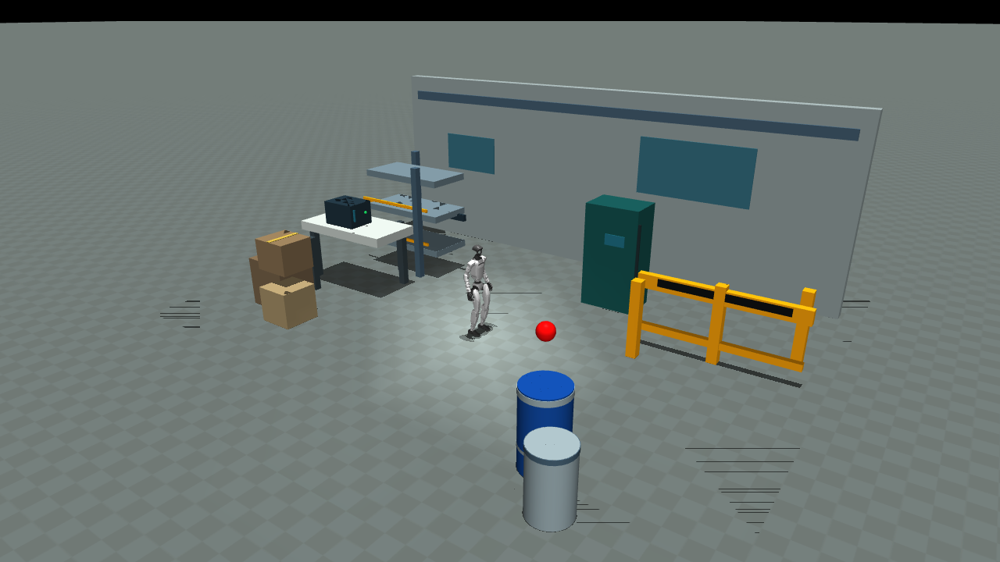
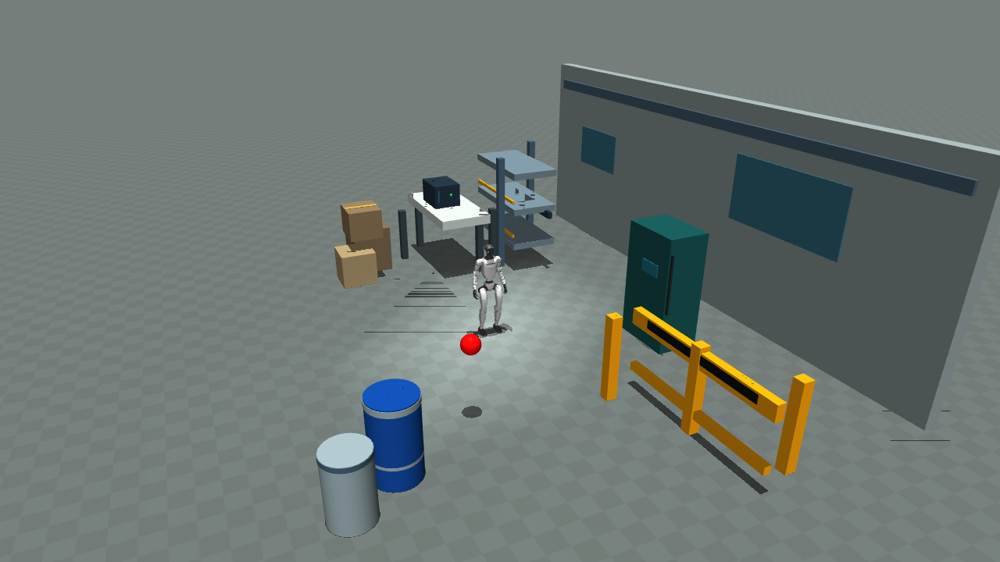
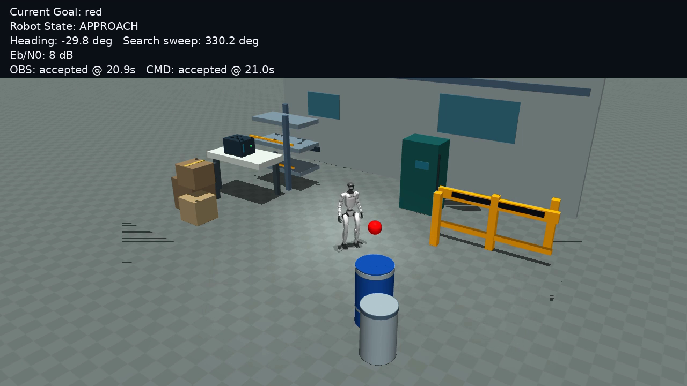
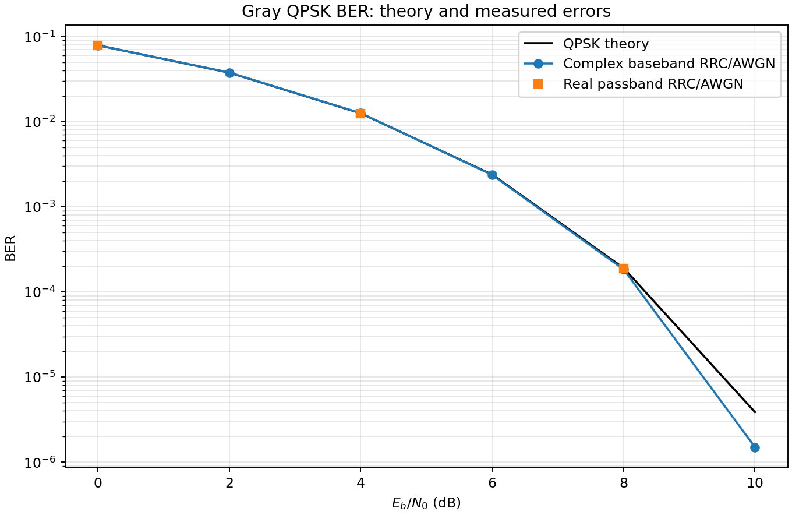
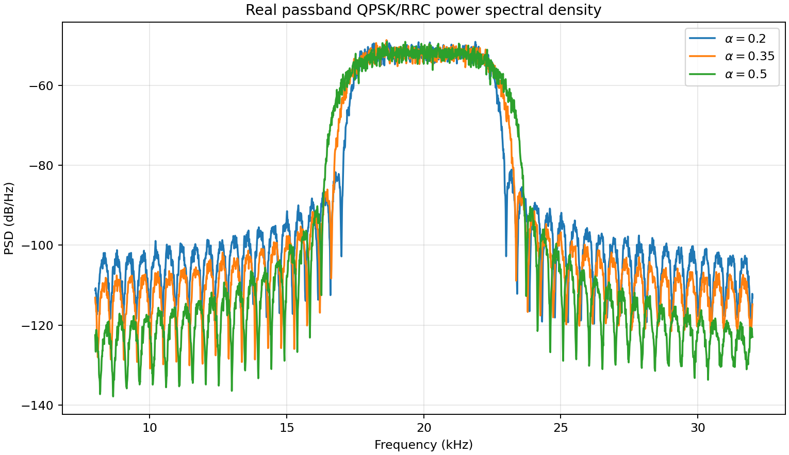
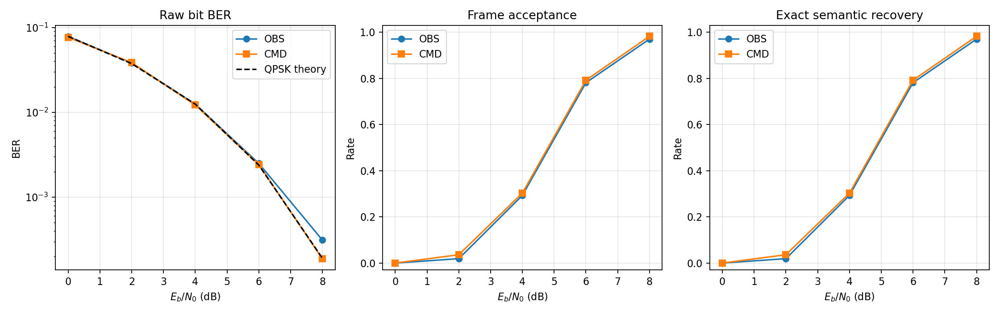

<div align="center">

# Embodied Semantic Communication

### A QPSK-Based Task-Oriented Communication System for Humanoid Robots

**From digital bits to embodied motion: a reproducible communication stack demonstrated in closed-loop Unitree G1 MuJoCo simulation.**

<br>


<br>

**[Project Website](https://suibianba12138.github.io/embodied-semantic-communication/)** &nbsp;·&nbsp;
**[Interactive Communication Replay](https://suibianba12138.github.io/embodied-semantic-communication/#demo)** &nbsp;·&nbsp;
**[PHY Implementation](P1_PHY_IMPLEMENTATION_REPORT.md)** &nbsp;·&nbsp;
**[G1 Experiment](P3_S1_V2_INDUSTRIAL_SHOWCASE_REPORT.md)**

</div>

---

## Overview

**Embodied Semantic Communication** is a communication-engineering course project connecting a numerically implemented digital physical layer with a physical robot task in simulation. Instead of stopping at a BER curve, the project transmits task-relevant observations and velocity commands over **bidirectional QPSK/AWGN communication links**, then observes their effect on the closed-loop motion of a simulated Unitree G1.

The design combines **Gray QPSK + RRC pulse shaping + matched filtering**, a **96-bit OBS/CMD protocol with CRC-16**, a **10 Hz bidirectional link**, and an existing **50 Hz G1 locomotion controller**. It demonstrates task-level transmission effects without retraining the robot.

<div align="center">



*Final industrial-laboratory demonstration · fixed layout with six industrial prop groups and 22 collidable MuJoCo geoms.*

</div>

> **What “semantic” means here:** hand-designed, task-specific structured fields (target color, distance, bearing and validity), **not** a learned image/video codec, generalized language understanding, or reversible RGB-D image compression.

## System Architecture

```text
                        SIMULATED UNITREE G1
                      ┌─────────────────────┐
                      │ RGB-D camera 64×48  │
                      │ color target search │
                      └──────────┬──────────┘
                                 │
                          OBS semantic fields
                                 │
                           96-bit Wire v1
                                 │
                       Gray QPSK + RRC + AWGN
                         10 Hz UPLINK (OBS)
                                 │
                                 ▼
                     ┌──────────────────────┐
                     │ EDGE TARGET CONTROL  │
                     │ SEARCH / ALIGN       │
                     │ APPROACH / STOP      │
                     └──────────┬───────────┘
                                │
                         96-bit CMD frame
                         vx / vy / wz / TTL
                                │
                       Gray QPSK + RRC + AWGN
                         10 Hz DOWNLINK (CMD)
                                │
                                ▼
                        G1 locomotion policy
                         50 Hz → MuJoCo
                                │
                            feedback ───────→ camera
```

| Component | Implementation | Evidence |
| :-- | :-- | :-- |
| Physical layer | Gray QPSK, complex-baseband and 20 kHz real-passband experiments, RRC shaping, matched filtering, AWGN | [P1 report](P1_PHY_IMPLEMENTATION_REPORT.md) |
| Frame protocol | 96 bits, CRC-16/CCITT-FALSE, version/type/sequence, OBS/CMD quantization and receive gating | [Frame codec](src/esc/frame.py) |
| Controller | Original V1.1 color-target controller; 10 Hz link and 50 Hz policy | [G1 report](P3_S1_V2_INDUSTRIAL_SHOWCASE_REPORT.md) |
| Visualization | Timestamp-linked recorded video, OBS/CMD packets, CRC rejection events and robot state | [Website demo](website/#demo) |

## Demonstration · G1 in an Industrial Laboratory

The final simulated scene contains a multi-level shelf, control cabinet, stacked boxes, safety barrier, drums and workbench. The G1 searches for an initially out-of-view red target, reacquires it, approaches and stops.

<div align="center">

| **Industrial scene** | **Observed robot motion** |
| :--: | :--: |
|  |  |
| Six industrial prop groups | Actual 8 dB QPSK/AWGN trial |

</div>

**[Watch real 8 dB experiment video](website/assets/video/industrial-awgn-8db.mp4)** · **[See first-person split view](website/assets/video/industrial-awgn-8db-split.mp4)** · **[Inspect synchronized receiver events](https://suibianba12138.github.io/embodied-semantic-communication/#demo)**

### Verified closed-loop results

| Condition | Task | Duration | Distance traveled | Bit errors | Accepted frames |
| :-- | :--: | --: | --: | --: | --: |
| Ideal scheduled messages | **PASS** | 26.32 s | 3.207 m | PHY N/A | 527 / 527 |
| QPSK, no noise | **PASS** | 26.32 s | 3.209 m | 0 / 50,592 | 527 / 527 |
| QPSK + 8 dB AWGN | **PASS** | 26.22 s | 3.202 m | 11 / 50,400 | 514 / 525 |

At 8 dB, **7 CRC rejections and 4 preamble rejections** occurred; no incorrect semantic payload was accepted. The robot still reached STOP in this one verified run. The six prop groups contain **22 collidable and 20 visual-only MuJoCo primitives**; no obstacle contact was observed in the three final traces.

**Boundary:** the environment deliberately preserves a clear route. This experiment does **not** demonstrate autonomous obstacle avoidance or general reliability across layouts/seeds.

## Communication Experiments

### QPSK · Physical Layer (P1)

- Gray mapping: `00 → +1+j`, `01 → +1−j`, `11 → −1−j`, `10 → −1+j`, each normalized by `√2`.
- Symbol rate: **4,800 Baud**; raw bit rate: **9,600 bps**.
- RRC: roll-off **0.35**, 161 taps, 16 samples/symbol, sample rate **76.8 kHz**.
- Real-passband verification: ideal-coherent numerical carrier at **20 kHz**.
- Theory: `P_b = Q(√(2E_b/N_0))` for uncoded Gray QPSK over AWGN.

<div align="center">



*Figure 1. BER vs. Eb/N0: theory, simulated baseband, and real-passband numerical validation.*



*Figure 2. RRC pulse-shaping and power spectrum.*

</div>

### Task-Oriented Semantic Framing (P2)

The 96-bit Wire v1 packet contains **16-bit preamble / 12-bit header / 52-bit payload / 16-bit CRC**. The OBS message carries target identity, range, bearing, validity and capture time. The CMD message carries velocity commands, TTL and mode. A CRC failure is rejected instead of delivering incorrect semantics to the controller.

Raw RGB-D data volume and a compact OBS frame are compared as **transport bit counts for different representations**, not equivalent image quality or general-purpose compression performance.

<div align="center">



*Figure 3. Message recovery and acceptance under channel noise.*

</div>

## Source Code and Reproduction

```text
embodied-semantic-communication/
├── src/esc/                 # QPSK, wire frame, link and scene helpers
├── experiments/             # Reproducible P1/P2 experiments and G1 scene configs
├── tests/                   # PHY, framing and experiment tests
├── website/
│   ├── index.html            # Academic project page + trace replay
│   ├── js/                   # Replay logic linked to recorded timestamps
│   ├── css/
│   └── assets/               # Selected verified images/videos/JSON
├── P1_PHY_IMPLEMENTATION_REPORT.md
├── P3_S1_V2_INDUSTRIAL_SHOWCASE_REPORT.md
└── WEBSITE_MEDIA_MANIFEST.json
```

**Independent P1 reproduction** (Python environment using `requirements-p1.txt`):

```bash
PYTHONPATH=src pytest -q tests/test_phy.py

MPLCONFIGDIR=/tmp/p1_mpl_cache PYTHONPATH=src \
  python experiments/p1_phy.py \
  --config experiments/p1_phy_config.json \
  --output artifacts/p1_phy
```

**Website replay** (no MuJoCo runtime required):

```bash
python -m http.server 8000 --directory website
# open http://localhost:8000
```

**Important:** This repository's initial Git whitelist deliberately excludes some machine-specific P3 runner code and third-party Candidate B/G1 assets. Therefore, a fresh clone does **not** provide turnkey full G1 simulation. Python PHY and website assets are independently inspectable.

## Documentation

| Resource | Contents |
| :-- | :-- |
| [Website / Replay Guide](website/README.md) | Static browser demo and trace synchronization |
| [PHY README](P1_PHY_README.md) | Run P1 tests and regenerate physical-layer results |
| [PHY Implementation Report](P1_PHY_IMPLEMENTATION_REPORT.md) | Equations, measured BER, passband verification |
| [Industrial Showcase Report](P3_S1_V2_INDUSTRIAL_SHOWCASE_REPORT.md) | G1 experiment protocol, metrics and limits |
| [Media Provenance Manifest](WEBSITE_MEDIA_MANIFEST.json) | Exact source/export paths and SHA256 checks |

## Scope, Licenses and Credits

- **Simulation only:** the AWGN channel and QPSK waveforms are computed numerically; no over-the-air hardware.
- **Existing robot controller:** existing Unitree G1 ONNX policy and V1.1 color-target controller are reused, not trained or newly developed as VLA.
- **Single fixed scene:** the industrial layout was chosen with a clear path; 3 successful runs do not prove collision-avoidance or multi-seed robustness.
- **Code licensing:** no project license has been selected. The presence of source code is not a grant of reuse rights.
- **Third-party assets/media:** the full G1 policy/model assets are not redistributed here, and public display/redistribution rights for G1-derived screenshots and videos remain under review.

---

<div align="center">

**Embodied Semantic Communication · Communication Engineering Course Project**

[Project Website](https://suibianba12138.github.io/embodied-semantic-communication/) · [Recorded Demo](https://suibianba12138.github.io/embodied-semantic-communication/#demo) · [Source](src/esc/) · [Reproduction](P1_PHY_README.md)

</div>
